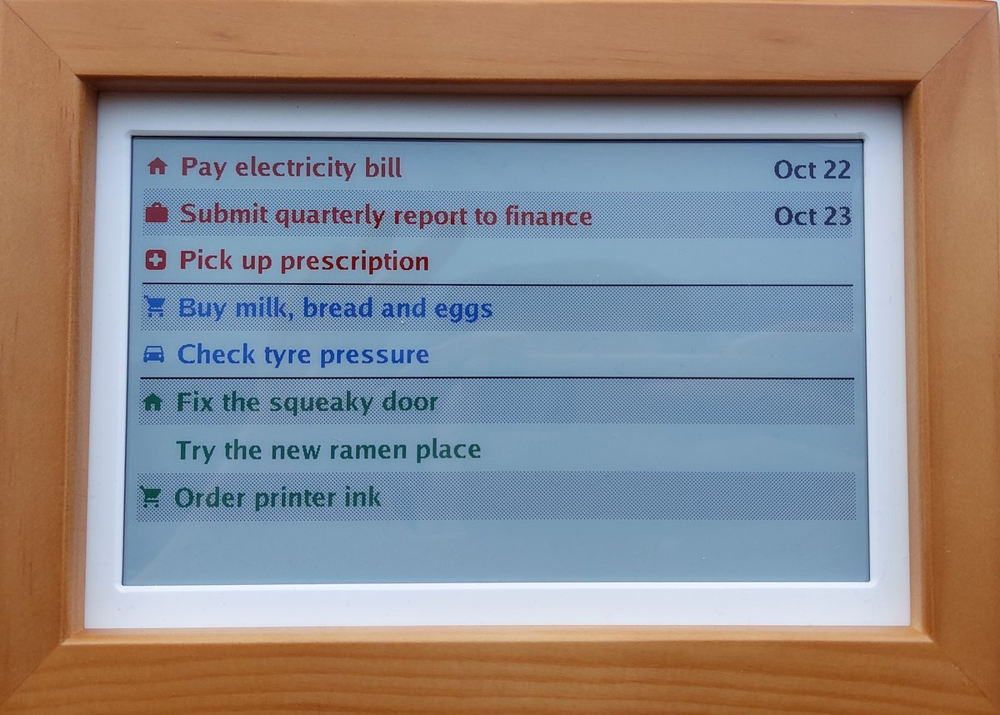
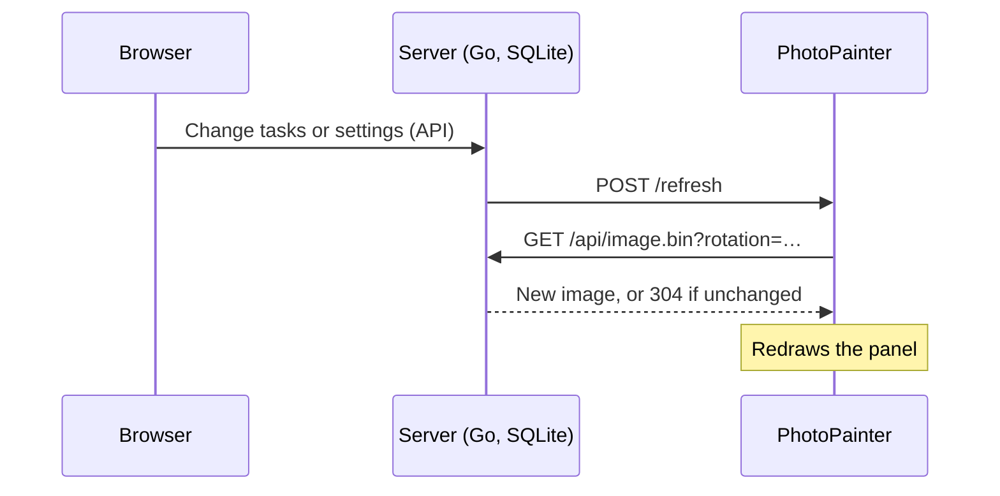

# Tabula

A to-do list kept by a small Go server and shown on a [Waveshare ESP32-S3 PhotoPainter](https://www.waveshare.com/wiki/ESP32-S3-PhotoPainter) (7.3" 6-colour e-paper). You edit tasks in the browser; the server draws the list as an image and tells the device to fetch it.



## How it works



## Make

Run from the top folder:

| Command | What it does |
|---|---|
| `make` | Builds the server and the firmware |
| `make run` | Builds and starts the server |
| `make firmware` | Builds the firmware |
| `make flash` | Builds the firmware and writes it to the board at `/dev/ttyACM0`; `make flash PORT=…` for another port |

The firmware commands load [ESP-IDF](https://docs.espressif.com/projects/esp-idf/en/v5.5.6/esp32s3/get-started/index.html) from `~/esp/esp-idf/export.sh`, unless `idf.py` already works in the terminal. If it's installed elsewhere, add `IDF_EXPORT=path/to/export.sh`.

## Server

```bash
make run                      # or in server/: go run .
```

It listens on port 1337 (http://tabula:1337) and keeps tasks in `tabula.db`. To change settings, copy `config.example.json` to `config.json` and edit it; `-config path` picks another file.

| Setting | Meaning |
|---|---|
| `listen` | Address and port, e.g. `":1337"` |
| `db` | SQLite file |
| `auth.user`, `auth.password` | HTTP basic auth for the pages and API; both empty = no auth. Set the same in the firmware. Plain HTTP sends them unencrypted, so this keeps out casual visitors, not someone reading network traffic |
| `image.margin` | `top`, `right`, `bottom`, `left` in px |
| `image.font` | Path to a `.ttf`/`.otf`, e.g. the included `fonts/Go-Bold.ttf`; empty = built-in Go Regular |
| `image.font_size` | px; icons follow it |
| `image.line_spacing` | Multiple of the font's line height, between wrapped lines |
| `image.task_spacing` | Extra px between tasks |
| `image.date_format` | Go date layout: `"Jan 2"` → Oct 24, `"02.01"` → 24.10 |

The rotation isn't a server setting: it's set on the device with the KEY button and sent with each image request. The server learns the device's address and rotation when the device downloads its image. It asks the device to refresh whenever the image changes and once on startup, so config changes show up after a restart.

The device shows open tasks of all categories, or of just one: pick it under **Preview** in the browser. Deleting that category puts it back to all.

Tests: `go test ./...`

## PhotoPainter controls

| Control | What it does |
|---|---|
| **BOOT**, short press | Downloads the image and redraws it, even if nothing changed. If the last redraw was under 30 s ago, it waits until then |
| **KEY**, short press | Turns the image 90° clockwise; press twice for 180°. Redraws once, 3 s after the last press. The rotation is kept across restarts |
| Green LED | Blinks on each press |
| Press longer than 1 s | Ignored |
| Hold **BOOT** while plugging in | Download mode, for flashing ([Flash](firmware/README.md#flash)) |

The 30 s pause is `CONFIG_TABULA_BUTTON_MIN_REDRAW_INTERVAL_S` in the [firmware settings](firmware/README.md#settings).

## Firmware

The device runs its own firmware, written in C for ESP-IDF 5.5. How to build it, flash it and set its Wi-Fi and server settings, and what the device does: [firmware/README.md](firmware/README.md).
